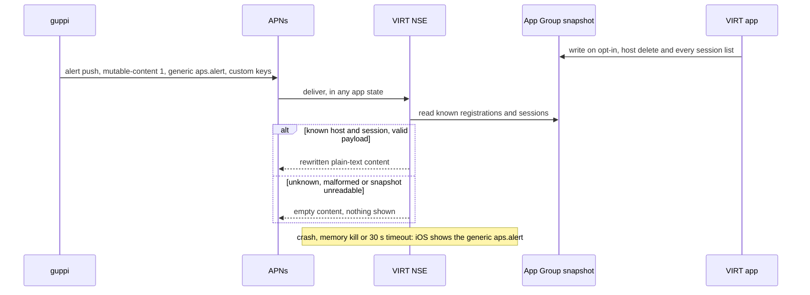

# Can iOS keep unknown pushes off the screen?

The feasibility check that [#79](https://github.com/eridanilabs/VIRT/issues/79) asks for before any push work in [#61](https://github.com/eridanilabs/VIRT/issues/61).

**Status:** escalated to the maintainer. No push code is built until the decisions below are made.

## The requirement

#79 and #61's groom comment say:

> Unknown-host and unknown-session pushes must never display, including through iOS when VIRT is backgrounded or closed. Verify whether iOS can enforce this, including when a notification extension or other validation mechanism cannot run, fails, or times out. Validate how known sessions are established when the app is not running. If the guarantee cannot be made, stop and escalate to the maintainer; do not weaken the requirement or enable push.

#79 also needs the opposite: known notifications still work when VIRT is backgrounded or closed.

## Verdict

**Not guaranteeable as #79 is written.** No iOS mechanism meets both halves of the requirement at once.

- With an alert push, iOS shows the push's original `aps.alert` text whenever the notification service extension (NSE) doesn't finish: a crash, a kill for memory, or the 30-second limit. That holds with or without the filtering entitlement. Apple documents it for every case where the content handler isn't called.
- With a background push, iOS itself never shows anything, so unknown pushes never display. But iOS throttles background pushes, holds only the newest, and drops them once the person force-quits VIRT. Known alerts then don't work when VIRT is closed.

The closest design, below, needs Apple's filtering entitlement. It suppresses every unknown push whenever the extension runs to completion, and fails closed when its validation state is missing or unreadable. Its one residual case: if the extension itself crashes, is killed or times out, iOS shows guppi's **generic, non-identifying fallback text** (for example "A session on one of your hosts changed"), for a known or an unknown push alike. That is a display, so it doesn't meet "never display". The maintainer decides whether to accept it (see [Decisions for the maintainer](#decisions-for-the-maintainer)).

## What iOS does

### The notification service extension

An NSE is a separate app-extension process that iOS launches when an alert push arrives, whether VIRT is in the foreground, suspended, terminated or force-quit. It runs only when the push has `mutable-content: 1` and an `alert` with a title, subtitle or body ([Modifying content in newly delivered notifications](https://developer.apple.com/documentation/usernotifications/modifying-content-in-newly-delivered-notifications)).

What iOS shows for each outcome:

| Outcome | What iOS shows | Source |
|---|---|---|
| The NSE calls the content handler with new content | The new content | [`didReceive(_:withContentHandler:)`](https://developer.apple.com/documentation/usernotifications/unnotificationserviceextension/didreceive(_:withcontenthandler:)) |
| The NSE calls it with empty content, **with** the filtering entitlement | Nothing | [`com.apple.developer.usernotifications.filtering`](https://developer.apple.com/documentation/bundleresources/entitlements/com.apple.developer.usernotifications.filtering) |
| The NSE calls it with content that has no alert text, **without** the entitlement | The original content | [`didReceive(_:withContentHandler:)`](https://developer.apple.com/documentation/usernotifications/unnotificationserviceextension/didreceive(_:withcontenthandler:)): "If the content object doesn't contain any alert text, the system ignores your modifications and delivers the original notification content." |
| The NSE takes longer than about 30 seconds | iOS calls `serviceExtensionTimeWillExpire()`; if the handler still isn't called, the original content | [`serviceExtensionTimeWillExpire()`](https://developer.apple.com/documentation/usernotifications/unnotificationserviceextension/serviceextensiontimewillexpire()), [`UNNotificationServiceExtension`](https://developer.apple.com/documentation/usernotifications/unnotificationserviceextension) |
| The NSE crashes or is killed, for example over its memory limit | The original content, because the handler is never called | [Modifying content…](https://developer.apple.com/documentation/usernotifications/modifying-content-in-newly-delivered-notifications): "If you fail to call the completion handler from either method, the system displays the original contents of the notification." Extensions have much lower memory limits than apps ([App Extension Programming Guide](https://developer.apple.com/library/archive/documentation/General/Conceptual/ExtensibilityPG/ExtensionCreation.html)). |
| The push lacks `mutable-content` or an alert | The original content, with no NSE | [Modifying content…](https://developer.apple.com/documentation/usernotifications/modifying-content-in-newly-delivered-notifications) |
| The push is sent without `apns-push-type: alert` | The banner, even with the entitlement | [`com.apple.developer.usernotifications.filtering`](https://developer.apple.com/documentation/bundleresources/entitlements/com.apple.developer.usernotifications.filtering): "Otherwise, the system always displays the notification banner to the user." |

So the original `aps.alert` is always a possible display. The NSE can make that display rare, not impossible.

### The filtering entitlement

`com.apple.developer.usernotifications.filtering` lets the NSE drop a push: it passes an empty `UNNotificationContent` (no title, subtitle, body, attachments or sound) to the content handler ([docs](https://developer.apple.com/documentation/bundleresources/entitlements/com.apple.developer.usernotifications.filtering)).

- **It needs Apple's approval.** The team applies through the [notification service entitlement request](https://developer.apple.com/contact/request/notification-service), behind an Apple Developer sign-in. Apple doesn't publish its criteria, and approval isn't guaranteed. Developers on the Apple Developer Forums report that it's granted to the team account, not to one app.
- **It needs the paid Apple Developer Program**, which #61 already requires for APNs.
- **It goes on the NSE target's entitlements only**, not the app's.
- **The push must carry `apns-push-type: alert`.**
- **It only works when the NSE completes.** It adds no protection against a crash, a kill or the timeout.
- **It fits VIRT.** Dropping pushes for hosts and sessions VIRT doesn't know is the filtering it's for, and it's the only way to suppress an alert push at all. Without it, an NSE can only rewrite an unknown push, never hide it.

### Background pushes and local notifications

A background push (`aps` with only `content-available: 1`, `apns-push-type: background`, `apns-priority: 5`) never shows anything by itself. It wakes VIRT, which could validate the push and post a local notification only for a known host and session ([Pushing background updates to your app](https://developer.apple.com/documentation/usernotifications/pushing-background-updates-to-your-app)).

That gives the strict guarantee: nothing displays unless VIRT's own code posts it after validating the push. If validation can't run, nothing shows. But for known alerts:

- iOS treats background pushes as low priority, doesn't guarantee delivery and throttles them. Apple says not to send more than two or three an hour.
- While iOS delays delivery it holds only the newest one, and discards it if the app is force-quit or killed.
- iOS doesn't launch an app the person force-quit until they open it again or restart the device ([`application(_:didReceiveRemoteNotification:fetchCompletionHandler:)`](https://developer.apple.com/documentation/uikit/uiapplicationdelegate/application(_:didreceiveremotenotification:fetchcompletionhandler:))).
- APNs may also hold, batch or drop priority-5 pushes depending on the device's power state ([Sending notification requests to APNs](https://developer.apple.com/documentation/usernotifications/sending-notification-requests-to-apns)).

Several sessions finishing within an hour, or a person swiping VIRT away, loses alerts. That fails #79's "known notifications still work when the app is backgrounded or closed".

### Generic fallback text

Whatever design is used, guppi's `aps.alert` is what iOS shows when the NSE fails. If it holds only fixed, generic text, with the session title, host and state in custom keys outside `aps`, a failure never puts host text on the lock screen. That limits the harm of the residual case. It doesn't remove it: a generic alert for an unknown host is still a display.

## Where the NSE gets its validation state

The NSE may run while VIRT isn't running, so it can't ask VIRT. It needs its own copy of what VIRT knows.

### Today

- VIRT has one app target and one test target. There's no extension, no entitlements file, no App Group and no Push Notifications capability.
- Saved hosts are JSON in `UserDefaults.standard` (`HostStore`), which an extension can't read.
- Host tokens are in the Keychain under the service `com.eridanilabs.virt.host-token`, with no shared access group.
- Session lists exist only in memory: `HostConnector.sessionUpdates(for:)` streams them, and `SessionAlertPresenter.latestRows` keeps the latest per host. Nothing is written to disk.
- `SessionAlert` (host id, session URI, kind, title) and `SessionAlertPresenter` (#59) handle alerts only while VIRT is open.

### Proposed: a validation snapshot in an App Group

An App Group gives the app and the NSE a shared container ([`com.apple.security.application-groups`](https://developer.apple.com/documentation/bundleresources/entitlements/com.apple.security.application-groups), [`containerURL(forSecurityApplicationGroupIdentifier:)`](https://developer.apple.com/documentation/foundation/filemanager/containerurl(forsecurityapplicationgroupidentifier:))). The app writes one small JSON file there, and the NSE only reads it.

- **What it holds:** a schema version and, for each host with push turned on, VIRT's host id, the registration id guppi returned (see the contract below), and the session URIs from the last session list VIRT saw for that host. No tokens, registration secrets, host URLs, host names or session titles.
- **When the app writes it:** when push is turned on or off for a host, when a host is deleted (before unregistering, so a failed unregister can't leave the host known), and on every session list from `sessionUpdates(for:)` for an opted-in host. It writes atomically.
- **File protection:** `completeUntilFirstUserAuthentication`, so it's readable once the device has been unlocked since boot ([docs](https://developer.apple.com/documentation/foundation/fileprotectiontype/completeuntilfirstuserauthentication)).
- **No Keychain or network in the NSE.** It doesn't connect to the host. That keeps it fast and small, well inside the timeout and memory limit, and keeps secrets out of it.

### When the snapshot is missing or stale

The NSE fails closed: when in doubt, it drops the push. This needs the filtering entitlement.

| Case | Result |
|---|---|
| No file yet (push never turned on, fresh install) | Dropped. |
| File unreadable (before the first unlock after a restart), corrupt, or an unknown schema version | Dropped. Known alerts in that window are lost. |
| Push for a registration id not in the file (host deleted, push turned off, unregister failed) | Dropped. |
| Push for a known host and a session not in the file | Dropped. **This includes sessions created on the host after VIRT last connected** (see decision 3). |
| Push for a known host and session that has since ended on the host | Shown. VIRT knew the session, and #80's tap routing ignores a session that's gone. |
| Malformed payload (strict decoding fails, unknown version or kind) | Dropped. |

### Rejected: the NSE asks the host

The NSE could read the host token from a shared Keychain group and ask the host over AHP whether the session exists. That needs the tailnet up, a WebSocket, the AHP handshake and a session list, all inside 30 seconds and the extension's memory limit. Every extra step is another way to reach the timeout, and the timeout shows the original content. It also puts the host token in a second process. It doesn't help the guarantee and makes the residual case more likely.

## Recommended design

Only if the maintainer accepts the residual case. Otherwise, stop.

1. **Apply for the filtering entitlement first.** Without it there's no design to build: an NSE can't hide an unknown push.
2. **Add the targets:** a Notification Service Extension target (`com.eridanilabs.virt.notification-service`), an App Group (`group.com.eridanilabs.virt`) on the app and the NSE, and the filtering entitlement on the NSE only. Push Notifications (`aps-environment`) stays in #81.
3. **Put the logic in VIRTKit**, so it's tested offline: strict payload decoding into `SessionAlert`, the snapshot type and its validation, and the plain-text content. The NSE target is a thin shell around it: read the snapshot, decode, validate, then pass either empty content or a `UNMutableNotificationContent` built from the `SessionAlert`.
4. **Keep the NSE small:** no network, no Keychain, no SwiftUI, one small file read. Pass empty content from `serviceExtensionTimeWillExpire()` too, so a slow run still fails closed while the process is alive.
5. **In the foreground**, `userNotificationCenter(_:willPresent:)` decodes the same payload and hands the `SessionAlert` to `SessionAlertPresenter`, which already drops repeats of the same host, session and kind. It asks for no system presentation when the live connection already showed the alert.
6. **Verify on a device**, with a development build that has the entitlement:
   - Unknown registration id, unknown session and malformed payload: nothing shown in the foreground, in the background, after force-quit, while locked, and before the first unlock.
   - Known host and session: shown in each of those states, except before the first unlock.
   - A debug-only NSE that crashes, and one that sleeps past 30 seconds: iOS shows exactly guppi's generic text, and nothing host-supplied.
   - With a paired Apple Watch, and with iPhone Mirroring on a Mac: they show the NSE's result, not the original. This is unverified.

## What guppi's payload contract must include

For the `docs/spec/` contract in eridanilabs/guppi#920, whichever way the maintainer decides:

- **`apns-push-type: alert`** on every session push. The filtering entitlement does nothing without it. Never `background` for these pushes.
- **`aps.mutable-content: 1`**, so the NSE runs.
- **A fixed, generic `aps.alert`** (title and body) with no host name, session title, state or URI. iOS shows it when the NSE fails. The contract documents the exact strings; VIRT never shows them on the normal path.
- **Every host-supplied value in custom keys outside `aps`**: the `ahp-session:` URI, the event kind, and the title, cut to a fixed length.
- **A registration id:** an opaque id guppi returns when VIRT registers a device and puts in every push. VIRT's host ids are local UUIDs that guppi doesn't know, and a host name or URL in the payload is neither something VIRT can trust nor something to send through Apple. The NSE maps the registration id to a saved host.
- **A payload version**, so the NSE drops versions it doesn't know.
- **An exact enum for the kind** that maps to `SessionAlert.Kind`: finished, input needed, failed.
- **Which other `aps` keys are sent** (`sound`, `badge`), so VIRT decodes strictly. No `content-available` on these pushes.
- **`apns-collapse-id` per session and `thread-id` per host**, as #920 proposes, are fine. The NSE sets its own thread id from the validated host.
- **Optional, for the maintainer:** a per-registration key, given to VIRT at registration and kept in the Keychain, with which guppi signs the custom keys. The NSE would then know a push came from that host, not only that it names a known registration id. It means the NSE reads the Keychain, which this design otherwise avoids.

## Decisions for the maintainer

1. **The residual case.** Do you accept that an NSE crash, kill or timeout shows guppi's generic text, for a known or an unknown push? If not, push can't ship with alerts that work while VIRT is closed, and #79, #80 and #81 stay blocked.
2. **If not, background pushes instead?** They meet "never display" strictly but break "known notifications still work when closed": a few an hour at most, and nothing after a force-quit. That changes #79's acceptance criteria, which is the maintainer's call, not the builder's.
3. **What a known session is.** With a snapshot, a session created on the host after VIRT last connected is unknown, so its alerts are dropped: alerts cover only sessions VIRT has already seen. The alternative, any session on a known host, weakens #79's unknown-session rule.
4. **Apply for the filtering entitlement.** Every alert-push design needs it, and Apple may decline. If it does, see decision 2.
